# PROYECTO BELLOTA

**Hecho por [KOSA Studio]** compuesto por: Santiago Salto Molodojen, Zhuokai Zhu, Óscar Silva Urbina y Alejandro Menéndez Fierro.

---

El juego "Proyecto Bellota" se trata de un trabajo universitario hecho en la UCM. La principal intención que tuvimos a la hora de crear este proyecto era crear un plataformero que se inspira en los que se habían hecho anteriormente, con una combinación de sensación de presión de tiempo (o un contrarreloj para ser exactos) y varios puzzles con distintas mecánicas que se juntarían para hacer niveles donde puedes ser rápido mientras que al mismo tiempo trabajas con lo que se te da para atravesar obstáculos difíciles de atravesar sin algo de razonamiento de tu lado.

  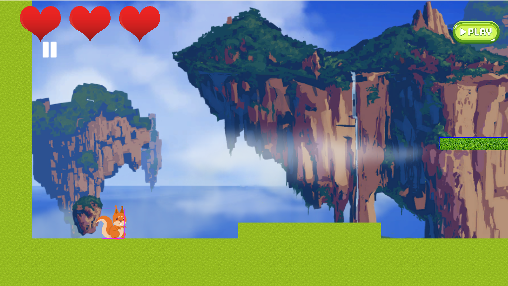

  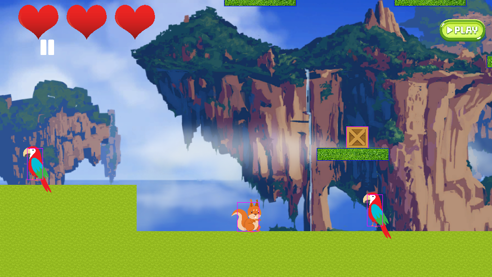

  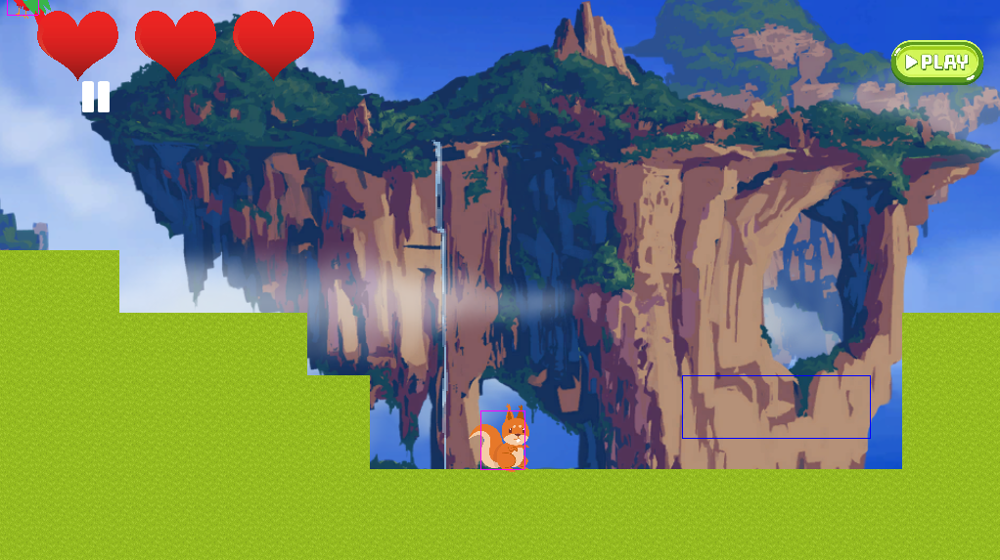

---

# DOCUMENTO DE DISEÑO

## 1. Resumen

### 1.1 Descripción

Eres una ardilla exploradora, y te tendrás que hacer camino entre múltiples obstáculos, puzzles y enemigos antes de que se te acabe el tiempo.

### 1.2 Género

Plataformas, Niveles y puzzles.

### 1.3 Setting

En el mundo de (x) los loros Piratas de la isla de (x) se han propuesto conquistar el resto de islas. Para ello están recolectando los (símbolos) de poder de cada isla. de esa manera podrán debilitarlos lo suficiente para conquistar todo el archipiélago. Para detener esta catástrofe, (nombre) , nuestro protagonista, embarca con la misión de recuperar la mayor cantidad de símbolos antes de que caigan en manos de los Loros y reunir suficiente poder para poder derrotarlos.

### 1.4 Cartas usadas

  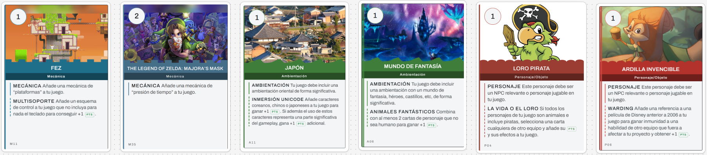

- **Fez:** niveles diseñados con plataformas. Bono extra: el juego solo se juega con el ratón. **+2p**
- **The legend of Zelda:** niveles en los que el jugador debe recolectar los puzzles (y a veces piezas de símbolos) bajo presión de tiempo para poder superarlos. **+2p**
- **Japón:** niveles diseñados con elementos asiáticos. Bono extra: el jugador tiene que recolectar los "trazos" de una palabra chino/japonés/koreano. **+3p**
- **Mundo de fantasía:** niveles diseñados con elementos de un mundo de fantasía. Bono extra: utilizar dos cartas de personajes no humanos. **+2p**
- **Loro pirata:** aparecerán loros piratas como enemigos. Bono extra: si todos los personajes del juego son no humanos, se podrá robar una carta de otro grupo y su punto. **+1p +?p**
- **Ardilla invencible:** aparecerá una ardilla como protagonista jugable del juego. Bono extra: hacer referencia a películas de Disney anteriores de 2006, utilizaremos la película Mulán para que se encaje con la carta Japón, y aparecerá el dragón Mushu. **+2p**

  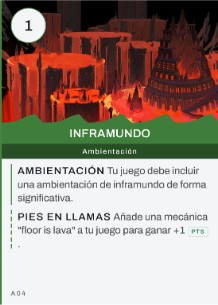

- **Inframundo:** Robada con la carta del loro pirata. Esta carta la usaremos para diseñar el último nivel del juego, y también usaremos la mecánica de "El Suelo es Lava" junto a varios obstáculos peligrosos. **+2p**

**Puntos totales: 12p + ?p**

---

## 2. Gameplay

### 2.1 Corto, Medio, Largo Plazo

**Corto:**
- Superar los elementos de plataformas.
- Superar a los enemigos, ya sea atacándolos o evitándolos.

**Medio:**
- Encontrar y recoger los coleccionables del nivel.

**Largo:**
- Acabar el nivel a tiempo.

### 2.2 Core Loops

2.2 Core Loops
Avanzar por el nivel, superar los obstáculos, recoger los coleccionables y terminar el nivel.

- **Victoria:** conseguir superar el nivel a tiempo y con los coleccionables necesarios.
- **Derrota:** quedarte sin vidas o no superar el nivel a tiempo. Esto hace que se tenga que reiniciar el nivel.

---

## 3. Mecánicas

### 3.1 Movimiento

El personaje se controla con el ratón. Al mover el cursor, se define la dirección en la que se desplazará el personaje. Si se hace clic izquierdo, el personaje avanza en la dirección indicada por el cursor. La velocidad depende de la distancia entre el cursor y el personaje: si está cerca, el personaje se mueve despacio, si está lejos, corre.

  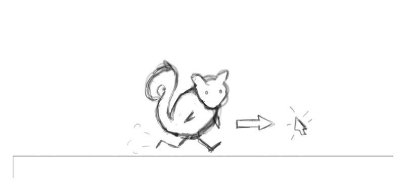

  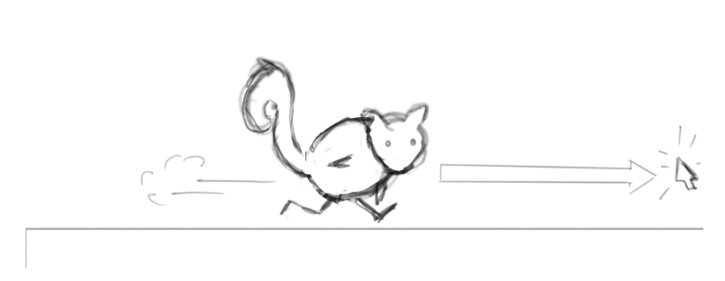

### 3.2 Salto

Para saltar, el sistema detecta si el cursor está colocado sobre el personaje respecto al eje y positivo. Si es así, el personaje saltará en la dirección a la que está apuntando el cursor. Al igual que con el movimiento en el suelo, alejar más el ratón del personaje hará que este salte más alto. Una vez en el aire aunque se deje de pulsar el “click” del ratón, el personaje mantendrá la dirección de movimiento por inercia. Aun así es posible modificar la dirección una vez en el aire (movimiento horizontal).

  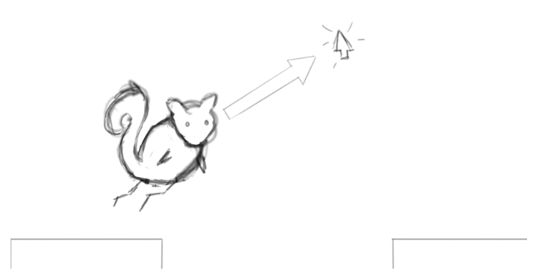

### 3.3 Ataque

Para atacar, se utiliza el clic derecho. Al pulsarlo el personaje entra en estado de ataque y se detiene, puesto que cuando se está en el estado de ataque, el jugador no puede moverse. En caso de activar el ataque mientras el jugador estaba saltando, este mantendrá la inercia y se seguirá moviendo en esa dirección. Así mismo se activará un bullet time event en este caso específico, donde se ralentizará el tiempo mientras está en modo ataque. Mientras se mantiene pulsado el clic derecho, el jugador puede apuntar en la dirección deseada, y al soltarlo, el personaje lanzará un proyectil en esa misma dirección, y dependiendo de la distancia arrastrado de la posición clickeado original, más fuerte se lanzará el proyectil.

El proyectil que se lanza en el ataque se mueve en forma de parábola. Este proyectil se usará para derrotar a enemigos, disparar a objetivos que activan mecanismos, o romper bloques frágiles que hay por el nivel. El ataque también puede empujar cajas irrompibles cuando impacta en ellas.

  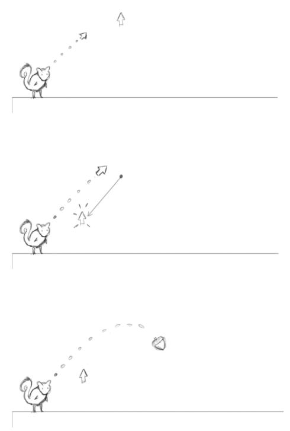

  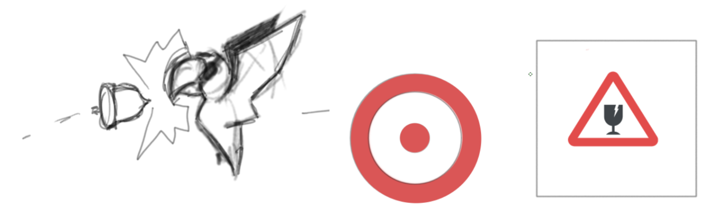

### 3.4 Recolección de símbolos

Cuando avanzas lo suficiente por el juego, se introduce una mecánica de recolección de piezas de una letra asiática (kanji) que hay que encontrar para poder salir del nivel. Las piezas se encontrarán por caminos alternativos del nivel fácilmente visibles y en medio de algunos puzzles.

Al conseguir todas las piezas el jugador recibe un potenciador de velocidad que le servirá para llegar más cómodamente a la salida del nivel. Para simbolizar el aura en el juego, se mostrará un efecto alrededor de la ardilla indicando que ha conseguido aura tras formar todos los símbolos del nivel.

### 3.5 Enemigos

A lo largo del nivel se encontrarán enemigos que servirán como obstáculo. Estos se pueden eliminar atacándolos o simplemente se pueden esquivar para seguir avanzando. No es necesario matarlos para completar el nivel.

- **Loro movimiento vertical:** este enemigo se moverá de arriba a abajo en bucle.
- **Loro movimiento horizontal:** este enemigo se mueve de derecha a izquierda en bucle.
- **Enemigo tira-proyectiles (OPCIONAL):** es un enemigo que lanza ataques a larga distancia, como referencia de los Hermanos Martillo de Mario Bros. Se ha diseñado para meter más jugabilidad al juego si el diseño de niveles es muy repetitivo.

  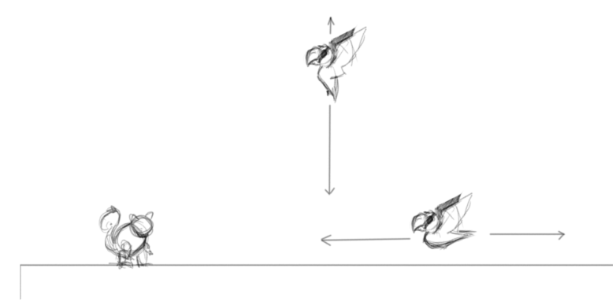

### 3.6 Tiempo límite y puntuación

Los niveles plantean al jugador el reto de explorar el escenario y encontrar una serie de símbolos perdidos para poder superarlos. Cada uno de estos niveles cuenta con un tiempo límite: cuanto más tiempo le sobre al jugador al completarlo, más puntos extra obtendrá. Por el contrario, si no consigue superar el nivel dentro del tiempo establecido, recibirá una penalización. Los enemigos derrotados también darán algo de puntuación. El daño que sufre el jugador a lo largo del nivel reduce ligeramente la puntuación que se puede conseguir al final del nivel.

### 3.6.1 Formas de conseguir puntos en los niveles:

1. **Completando el nivel sin requisitos:** Cuando el jugador complete el nivel con éxito, ganará una puntuación base para tener la posibilidad de conseguir al menos la primera estrella y (quizás) la segunda estrella siempre y cuando haya pasado un tiempo no muy prolongado en el nivel.

2. **Completando el nivel a tiempo:** Si el tiempo que pasas en el nivel es menor que el objetivo establecido, conseguirá una puntuación extra según lo rápido que lo ha vencido, con una potencia y un multiplicador (con un número constante cuyo valor desconocemos por ahora) para que se ajuste fácilmente a los otros parámetros de puntuación del nivel.

  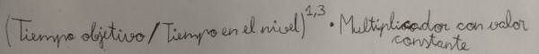

***Fórmula de puntuación por el tiempo tardado (sólo disponible cuando el tiempo objetivo del nivel > tiempo en el nivel)***

3. **Derrotando enemigos a lo largo del nivel:** Para que los enemigos hagan algo más que solo ser obstáculos por los niveles, haremos que te puntúen algo de puntuación según los que has derrotado del nivel. Por ejemplo, si derrotas a 8 enemigos en un nivel donde habían 12, ganarás la misma puntuación en ese nivel que en uno donde derrotas a 4 de 6. También estará un multiplicador de valor constante (tampoco lo hemos decidido todavía, pero seguramente sea distinto que el del tiempo ahorrado en el nivel)

  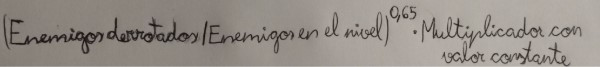

***Fórmula de puntuación por los enemigos derrotados***

4. **Vencer enemigos con proyectiles tirados con slow motion:** Aprovechando que tenemos la mecánica de aura, podemos hacer que eliminar enemigos con ataques de slow motion (o con el modo aura activo) te de un bonus pequeño de puntuación aparte del que ganas por derrotar a los enemigos.

## 3.6.2 Cómo puedes perder puntos en el nivel:

1. **Tardando demasiado tiempo en completar el nivel:** Si terminas tardando más tiempo que el que ponía en el objetivo, no sólo se anulará el bonus de puntos por tiempo ahorrado, sino que recibirás una penalización que reduciría toda la puntuación que consigues de los otros parámetros que te dan puntuación, aumentando su fuerza cuanto más tardes en completarlo después de superar el objetivo.

  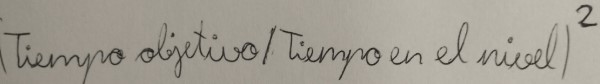

***Fórmula de puntuación por los enemigos derrotados***

2. **Sufriendo daño por el nivel:** Si recibes cualquier fuente de daño durante el nivel, se guardará si consigues completar el nivel para castigarte ligeramente por haber recibido daño. Por ahora, nuestro plan es que te quite una cantidad plana de puntuación por cada vida que pierda el jugador.

  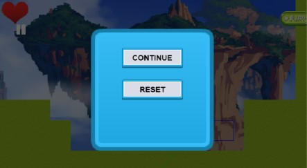

***La ventana que aparece cuando se completa el nivel***

  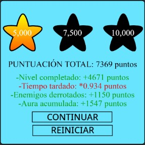

***Una representación de lo que saldrá  cuando completes el nivel (la pantalla todavía se oscurecerá como en la versión actual y la ventana tendría un tamaño muy parecido), con las estrellas teniendo un requisito de puntuación mínima encima suya para conseguirla. Abajo estará la puntuación total junto a todos los parámetros de puntuación que dan/quitan puntuación. Si al jugador le da tiempo a pasar el nivel antes del tiempo objetivo, se sustituirá la penalización por el bonus de puntuación por tiempo ahorrado.***

### 3.7 Niveles

Los primeros niveles del juego (unos 4 o 5) se van a utilizar para introducir al jugador a las mecánicas del juego:

Los primeros niveles del juego (unos 4 o 5) se van a utilizar para introducir al jugador a las mecánicas del juego.
- El **primer nivel** introducirá al jugador al movimiento del personaje. 
- El **segundo nivel** introducirá el ataque de la ardilla añadiendo unos bloques frágiles que bloquean el camino y al final unas dianas a las que hay que disparar para invocar una plataforma que lleve al final del nivel.
- El **tercer nivel** le enseñará al jugador los enemigos más sencillos (los que se mueven verticalmente y horizontalmente sin atacar) y varias camas de pinchos que pueden hacer daño a la ardilla.
- El **cuarto nivel** introduce brevemente las cajas irrompibles que se pueden empujar con el jugador y su proyectil de ataque.
- El **quinto (?) nivel** en adelante presentará la mecánica de símbolos que hay que recoger para poder salir del nivel actual, además de ir introduciendo progresivamente los objetos y mecánicas para los puzzles que hay que completar para seguir adelante en el juego.

Estos serán los objetos/obstáculos que se introducirán durante el tutorial y más adelante en el juego:

- **Plataformas que se mueven:** son como cualquier plataforma por la que la ardilla puede caminar, con la diferencia de que se moverán de una dirección a la siguiente lentamente. Podemos hacer que se muevan horizontalmente, verticalmente y hasta diagonalmente según la necesidad en el nivel.
- **Cajas frágiles e irrompibles:** el jugador las puede mover empujando desde un lado o usando el proyectil de ataque del personaje. Las cajas tendrán tamaños distintos. También habrá cajas frágiles de color azul aclarado que no pueden empujarse y se romperán tras tocar un ataque del jugador.

  

***La ardilla empujando una caja irrompible moviéndose hacia la derecha. También puedes mover la caja ligeramente con el ataque del jugador si es indestructible.***

- **Pinchos/bloques dañinos:** tocarlos daña al jugador y le quita una vida.

- **Pinchos más letales:** son más grandes, llamativos y quitan toda la vida. Están para darle más vida al ambiente, como alternativa a los huecos sin fondo, y también para dar más juego a los peligros que se le puedan presentar al jugador.

  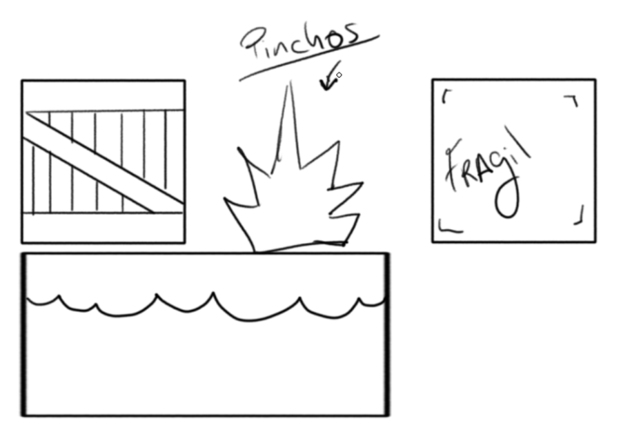

### 3.8 Controles

Solo se usarán el clic izquierdo y derecho del ratón, en combinación con el movimiento del ratón, que será apoyado/indicado con la aparición de un icono de cursor en la pantalla.

**Clic izquierdo:** nada más hacer clic izquierdo se entra en estado de movimiento, donde podemos ver 2 tipos de comportamiento:

- **Un clic:** la ardilla se mueve a la posición del cursor. Detectará si tiene que correr o saltar dependiendo de la posición del cursor respecto a la ardilla.
- **Mantener pulsado:** se detecta el input de movimiento de forma constante, y por lo tanto la ardilla seguirá continua e inmediatamente la dirección y posición del cursor a medida que el jugador va arrastrando el ratón.

  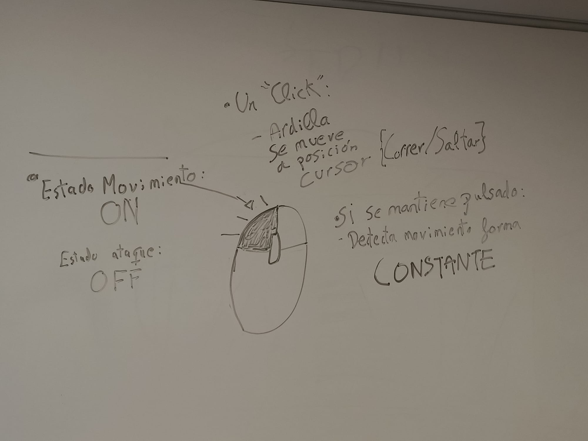

**Clic derecho:** se entra en el estado de ataque, donde la ardilla podrá lanzar proyectiles. Si está en tierra, se quedará quieta; si está en el aire, conservará la inercia del movimiento hasta quedarse sin ella. Podemos ver 2 tipos de comportamiento:

- **Mantener pulsado:** aparecerá una predicción de trayectoria y fuerza del proyectil, que el jugador podrá ir ajustando mediante el movimiento del ratón. Una vez soltado el botón, se efectuará el disparo.
- **Un clic:** al estar diseñado de forma que se haga un pre-aim a la hora de efectuar un ataque, en este caso, aunque no se pueda efectuar el primer paso de forma eficaz, se seguirá lanzando un proyectil, pero saldrá con una trayectoria totalmente errónea.

  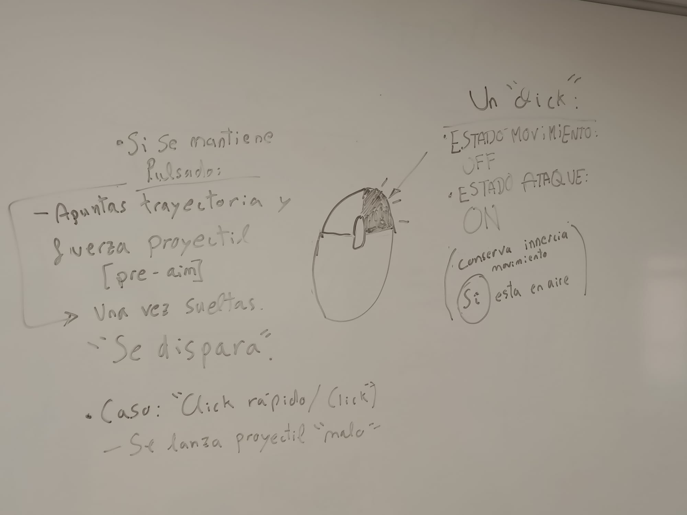

---

## 4. Diseño

### 4.1 Puzles

**Diana:**
Se presenta un camino sin salida, donde habrá una serie de dianas, moviéndose en constante movimiento hacia arriba y hacia abajo. La ardilla tendrá que acertar en todas, con su proyectil para poder accionar una plataforma, que le permitirá seguir con el nivel.
Habrá un instante donde con el pre-aim de la ardilla podrás acertar a todas las dianas a la vez, con un solo disparo. Aquí se presenta la dualidad de ser paciente y tirar todas de una, o ser ágil con el disparo y acertar disparando singularmente a cada una de ellas.

  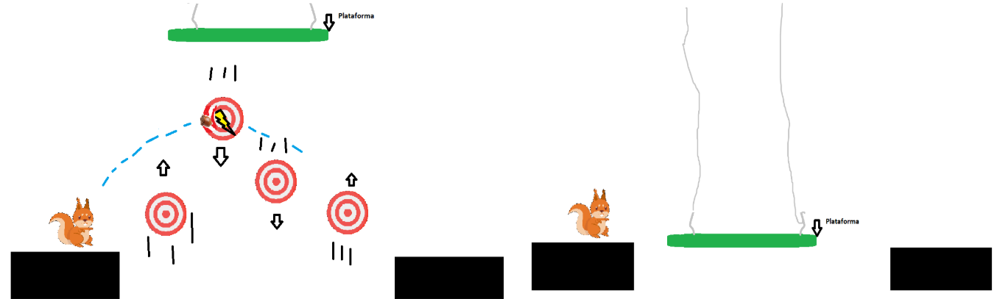

**Entorno interactuable:**
Se presenta de nuevo un camino, aparentemente sin salida. Mediante el uso del lenguaje visual, se presentará a la ardilla una pista de elementos de entorno con los que puede interactuar con su disparo para abrirse camino, tendrán que ser disparados una o varias veces dependiendo del elemento.

  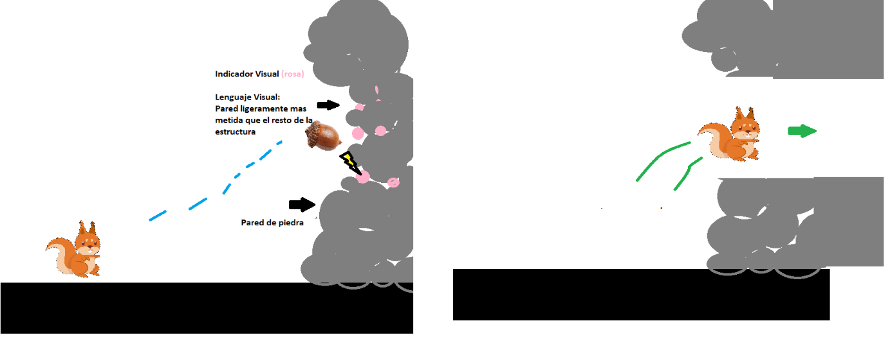

### 4.2 Mundos

- **Mundo Fantasía:** Tutorial.
- **Mundo Asiático:** Introducción de los símbolos.
- **Mundo Infierno:** Obstáculos mortales.

---

## 5. Interfaz

### 5.1 Menús

Los menús del juego son: el menú principal, el menú de selección de niveles, el menú de pausa durante un nivel, los ajustes fuera de un nivel y los créditos.

  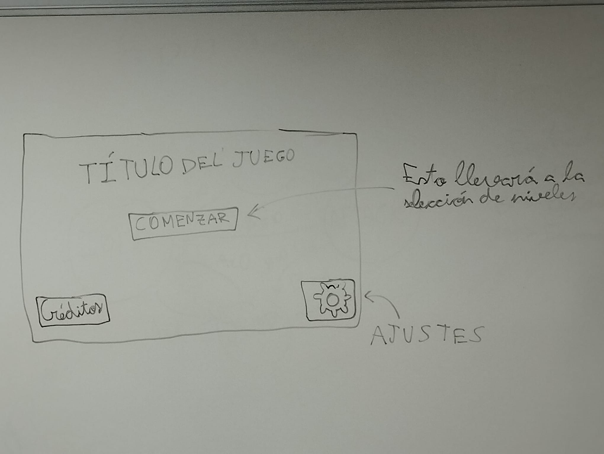

**Pantalla de menú principal**

  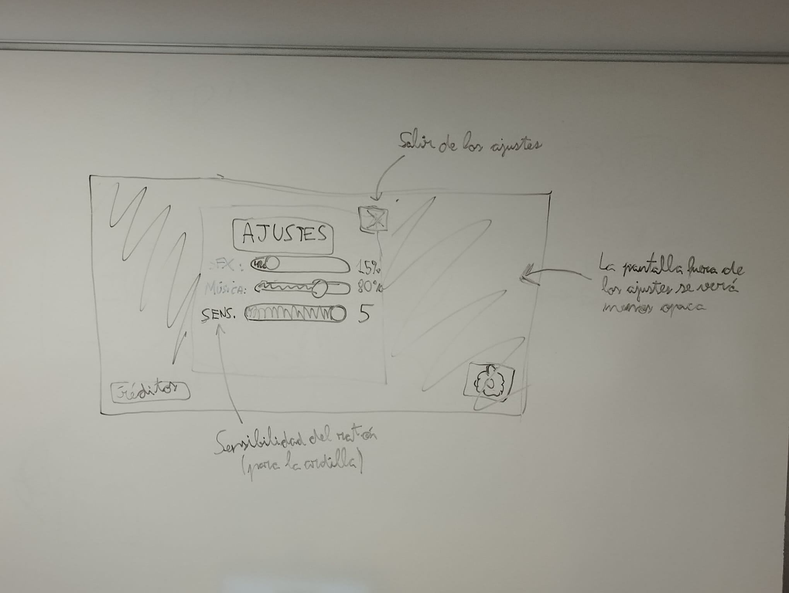

**Pantalla de ajustes** (una ventana emergente que se superpone a la pantalla de menú principal)

Notas extra: cuanta mayor sensibilidad en los ajustes (entre los valores 1 y 5), menos distancia/altura del cursor se necesitará para hacer que la ardilla corra/salte respectivamente. Cada barra de los ajustes, a la izquierda del deslizador, tendrá su mitad de color verde mientras que el resto se verá de negro.

  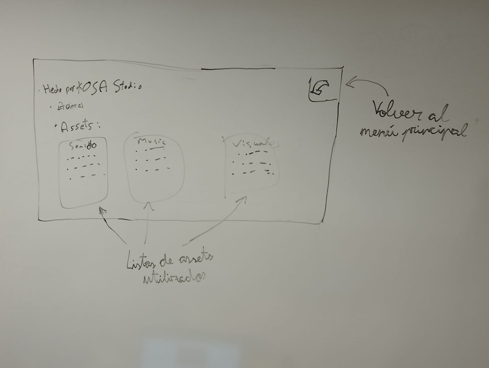

**Pantalla de créditos** (todavía no definitiva)

Tendrá 2 líneas de texto destinadas a nombrar el estudio y a los autores. Aunque principalmente se centrará en dar crédito a todos los assets utilizados (ya sean nuestros o utilizados), siendo estos divididos en las secciones de Sonido, Música y Visuales/Arte.

  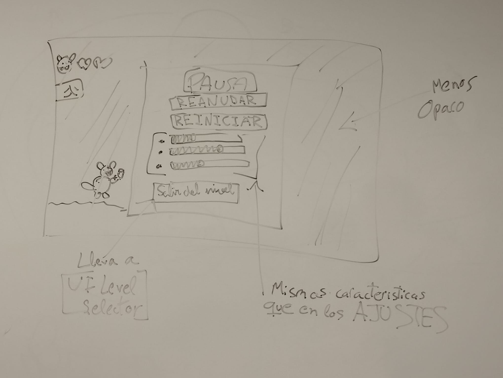

**Pantalla de pausa en un nivel**

Se presenta una ventana emergente en medio de la pantalla. Cuando sale, hace que la escena del nivel quede de fondo, con una tonalidad algo opaca. Tenemos los botones:

1. Reanudar la partida.
2. Reiniciar el Nivel.
3. Controladores, como en el menú de ajustes:
   - Sonido
   - SFX
   - Sensibilidad
4. Salir del Nivel: que te llevará al Selector de Niveles.

### 5.2 Niveles

  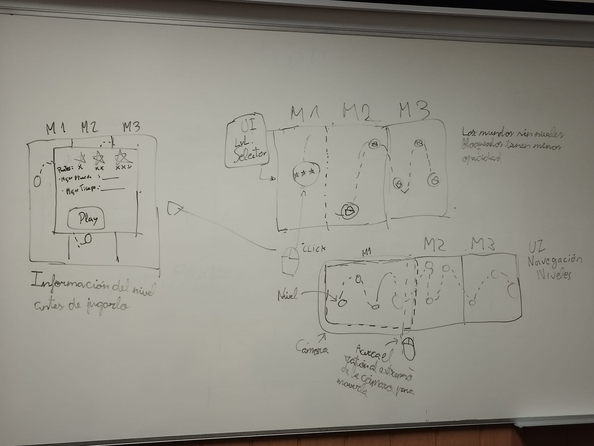

A la hora de seleccionar el nivel a jugar, como el mapa de niveles es más grande que la propia cámara, haremos que si acercas el ratón al extremo de la pantalla, la cámara se mueva hacia ese lado pasados unos pocos instantes si no alejando la pantalla de ese extremo.

Cuando el jugador pulse a un icono del nivel (es decir, un círculo que muestra las estrellas que ha conseguido el jugador si ya ha jugado el nivel, pero el cual estará vacío si no lo ha superado aún) se mostrará una ventana que indicará las estrellas conseguidas en el nivel, cómo se consiguen (requisito de puntos en el nivel para obtenerlas), la mejor puntuación en el nivel, y el mejor tiempo en el nivel, aprovechando la mecánica contrarreloj del juego y también para aportar algo de rejugabilidad al juego.

Los niveles deberán vencerse secuencialmente del primero al último y no se puede pasar al siguiente mundo hasta que ganes todos los niveles del mundo anterior. Los mundos inaccesibles se verán con un poco menos de opacidad de la normal, y los niveles bloqueados (es decir, los que no tienen su nivel anterior vencido) mostrarán un candado.

### 5.3 UI

La UI del juego durante el gameplay principal del juego es:

  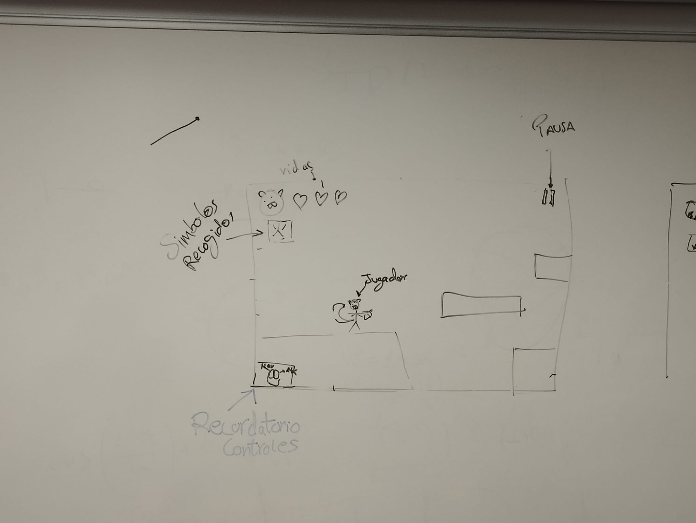

La pantalla del juego se verá completa, y se apreciarán en la esquina superior izquierda las vidas (corazones) de la ardilla, el progreso en la colección de las piezas del símbolo del nivel (si existe, que en caso de que no simplemente no estará presente en la interfaz), en la esquina superior derecha estará el botón de pausa, y en la esquina inferior izquierda se verá un recordatorio para los controles del juego (posiblemente se puedan quitar en los ajustes del juego).

---

## 6. Experiencia de juego

El nivel se presenta con una presión contrarreloj para acabarlo, donde para avanzar tendrás que realizar los movimientos adecuados con la ardilla, accionados por el movimiento del ratón, para superar el diseño plataformero del nivel, ya sea corriendo, saltando o esquivando a los enemigos que te vayas encontrando, con la posibilidad de eliminarlos mediante el modo ataque.

A medida que vas progresando en el nivel, te encontrarás con los distintos trozos de kanji a recoger para poder terminarlo. Para llegar a ellos tendrás que encontrar el camino correcto, ya sea mediante plataformas o la resolución de puzzles en los que interviene la mecánica de ataque como método de solución.

Finalmente, tras superar el nivel, se te dará un resultado en forma de puntuación que depende de factores como el tiempo tardado en completarlo y los enemigos derrotados. En función de cuántos puntos se hayan conseguido, el jugador podrá ser recompensado con estrellas en el nivel, con un máximo de 3. Cada una de las estrellas tiene un mínimo de puntuación a superar, siendo la 1.ª la más baja y la 3.ª la más alta.

---

## 7. Estética y Contenido

Buscamos simplicidad de formas, como en Mario Bros. Pero una paleta de color más suave como en la siguiente portada de Rayman, y evitar colores muy saturados.

<table>
  <tr>
    <td align="center">
      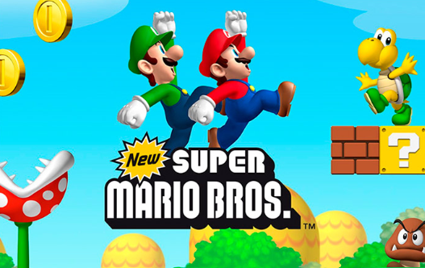
    </td>
    <td align="center">
      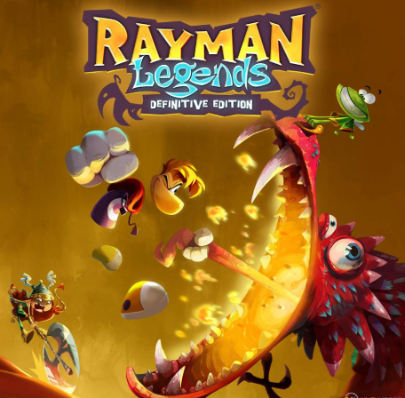
    </td>
  </tr>
</table>

---

## 8. Coding

### 8.1 State Pattern

Implementaremos una máquina de estados para gestionar los estados de la ardilla. Esta se compondrá de los siguientes estados:

  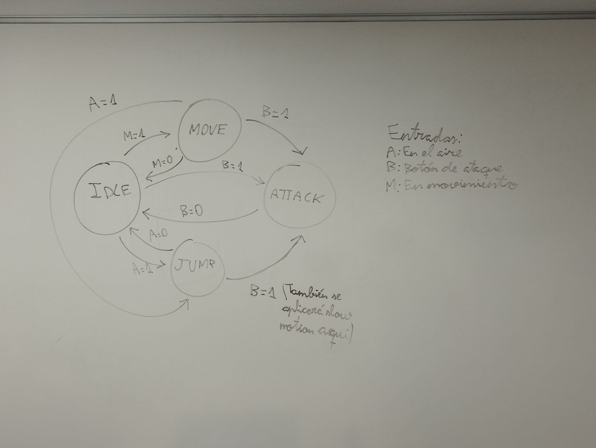

*El valor 0 indica false, mientras que el valor 1 indica true.*

### 8.2 Component Pattern

Aplicaremos el patrón de componentes para los elementos del juego que comparten comportamiento. Por ejemplo, los enemigos comparten el mismo tipo de movimiento (vertical u horizontal, variando únicamente el eje), colisionan con la ardilla, mueren al recibir el impacto de su proyectil, etc. Encapsular estos comportamientos en componentes evita duplicar código y facilita añadir nuevos enemigos.

---

## 9. Referencias

- **PopTropica:** en el movimiento con el ratón.
- **Raft Wars:** para el ataque del jugador.
- **Cut the Rope 2:** diseño de UI de selección de niveles.

---

# Assets del juego

Por el momento, todos los assets que hemos usado por el momento son algo simples y provisionales porque nos hemos centrado más en hacer el juego jugable. Intentaremos organizarnos para
ir trabajando en el arte y lo que nos queda del proyecto. Lo que tenemos pensado para el futuro es que se vieran un poco como Super Mario Bros, pero también con algo de detalle como en Rayman Legends. Por ahora, sin embargo, hemos optado por coger assets que encajaban más con Super Mario Bros, pero sin demasiados detalles y como ya he dicho antes, con una buena parte de simplicidad.

## Fuentes de los assets

- Ardilla (jugador): Pinterest.com (?): Licencia Libre
- Bellota (proyectil de ataque): Pngtree.com: Licencia Propietaria
- Loro (enemigo): Vecteezy.com: Licencia Propietaria
- Portal de la meta: itch.io : Licencia Libre
- Pinchos normales: Vecteezy.com (?): Licencia Propietaria
- Flecha de cursor: Flaticon.es: Licencia Propietaria
- Diana flotante: Pngtree.com: Licencia Propietaria
- Plataforma flotante de hierba: Pixabay (?):
- Botón de juego y "salida": Pinterest.com (?): Licencia Libre
- Estrella de puntuación: Kenney.nl (?): Licencia Libre
- Ventanas de UI: Kenney.nl (?): Licencia Libre
- Escenario del nivel/créditos: itch.io : Licencia Libre
- Escenario de selección de nivel: Pinterest.com (?)
- Corazón de vidas: Clipartpng.com: Licencia Propietaria (?)
- Caja de madera: Opengameart.org: Licencia Libre